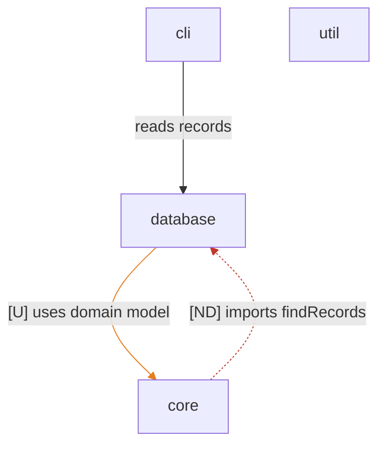

# Architecture

## Overview

Root units: the CLI reads through core, the database unit owns persistence, util holds trivia. The database unit declares a dependency on core that no code uses yet, and the core/parsers sub-unit reaches into the database unit undeclared.

## Diagram

## Units

- database
- cli
- core
  - core/model
  - core/parsers
- util
