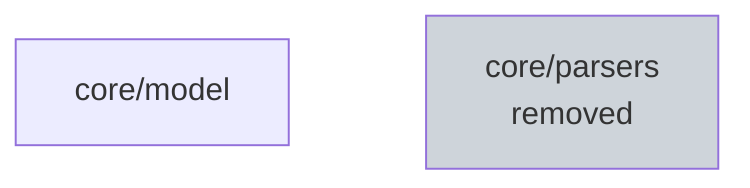

# core

## Responsibility

Shared domain model and input handling.

## Boundary

No persistence, no CLI.

## Rationale

A shared vocabulary prevents duplicated record handling.

## Observed

- no outgoing dependency on another unit (coverage complete)
- no direct ownership: subdivided into core/model, core/parsers
- scope files: 1, owned by sub-units: 1, gaps: none

## Diagram

