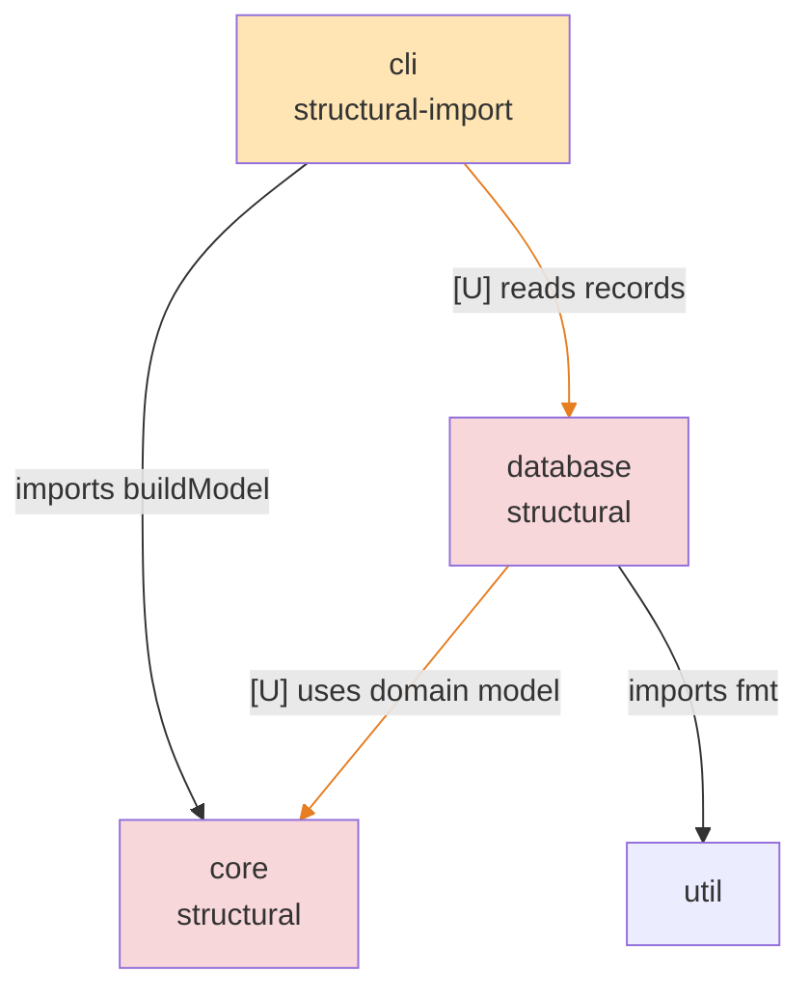

# Architecture

## Overview

Root units: the CLI reads through core, the database unit owns persistence with the new schema and replication modules, util holds trivia. The database unit still declares a dependency on core that no code uses.

## Diagram

## Units

- cli [structural-import]
- core [structural]
  - core/model
  - core/parsers [removed]
- database [structural]
  - database/schema [new]
  - database/store [new]
- util

## Diff summary

- base commit: d889302a20d18abe5f7fb16ffe7dc75c53d79ae2
- head commit: e6b9141b5a672b003cb429496eb6e69f47df1327
- tiers: cli=structural-import, core=structural, core/model=unchanged, core/parsers=removed, database=structural, util=unchanged, database/schema=new, database/store=new
- open proposals: promote-schema, partition-store, merge-core-into-database
