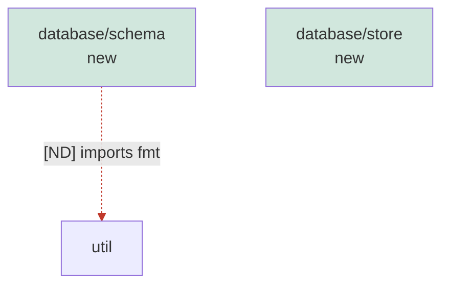

# database

## Responsibility

Own persistence and querying of records, in TypeScript and Go.

## Boundary

No CLI parsing, no domain policy. Callers reach it through the record store interface.

## Rationale

One write path for records keeps replication and queries coherent.

## Relationship: core (depends-on)

The database layer may use the shared domain model.

## Observed

- no outgoing dependency on another unit (coverage complete)
- no direct ownership: subdivided into database/schema, database/store
- scope files: 8, owned by sub-units: 8, gaps: none

## Diagram

