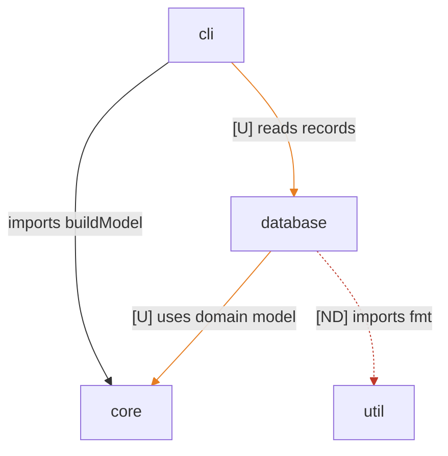

# Architecture

## Overview

Root units: the CLI reads through core, the database unit owns persistence with the new schema and replication modules, util holds trivia. The database unit still declares a dependency on core that no code uses.

## Diagram

## Units

- cli
- core
  - core/model
- database
  - database/schema
  - database/store
- util
