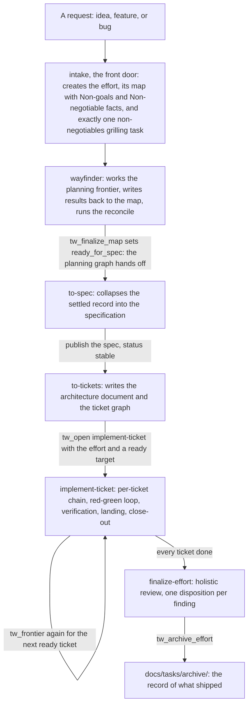
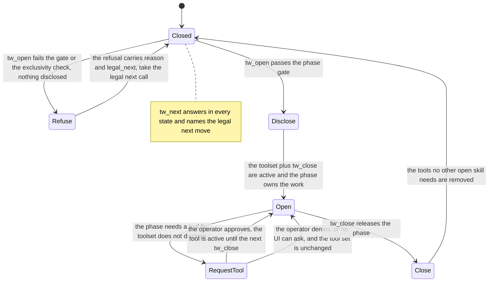

# Workflow internals

The internals reference for the task workflow: what an effort is, how the
`docs/tasks/` tree is laid out, and how the skills and the `tw_*` tools
actually behave. Read it to reorient when a tool refuses you or the workflow
surprises you, instead of grepping package source; the behavior contract for
a stuck run is the `workflow-failure` skill, and this file is the map that
skill points to. Every claim here is true of the shipped skills, tests, and
extension source as they exist today. Where a tool's actual refusal message
and this file ever disagree, the tool wins and the confusion is a review
finding, never an edit under `src/`.

## The big picture

An **effort** is the unit of work and the unit that archives: one directory
under `docs/tasks/` holding a map, its planning tasks, the specification,
the architecture document when one is needed, the implementation tickets,
and the review artifact. Every request becomes exactly one effort, and a
bug report becomes an effort whose defect is a `subtype: bug`
implementation ticket. There is no triage queue and no rejection path: the
intake phase is the single front door.

The actors:

- **The operator** decides. The tools put decisions to the operator; the
  one mid-run interactive ask is `tw_request_tool`, and an escalation never
  waits on an answer.
- **The phase skills** do the work. The disclosure registry carries seven:
  intake, setup-workflow, wayfinder, to-spec, to-tickets, implement-ticket,
  and finalize-effort. Each is opened by `tw_open`, the gate, and closed by
  `tw_close`.
- **The nested discipline** is skill-creator. It opens inside any open
  phase (its conflict list is empty) and discloses its own bundled script
  tools.
- **The failure surfaces** are task-workflow-doctor (the tree and opener
  diagnostician) and workflow-failure (the escalation ladder). Neither
  discloses workflow tools: the doctor routes, the ladder walks.
- **Inside implement-ticket**, the per-ticket chain runs as subagents: a
  tdd-worker in the red-green loop, then verification and landing.

The two graph kinds: an effort holds two independent dependency graphs, the
planning tasks and the implementation tickets. Edges (`blocked_by`) are
kind-scoped and effort-scoped, so a planning task blocks only planning
tasks and a ticket blocks only tickets of the same effort; the frontier and
the dependency levels are computed per kind.

The phase machine, front door to archive:

1. **intake** records the request and creates the effort: a map with its
   non-goals and non-negotiable facts, plus exactly one non-negotiables
   grilling task. A bug report becomes the effort's bug ticket.
2. **wayfinder** works the planning frontier, writes each result back to
   the map, and runs the reconcile, which sets `ready_for_spec` last.
3. **to-spec** collapses the settled record into the specification.
4. **to-tickets** turns a published spec into the living architecture
   document plus the ticket graph.
5. **implement-ticket** builds the ready frontier one ticket at a time in
   dependency-level order; each ticket lands with its close-out.
6. **finalize-effort** runs the holistic review, gives every finding a
   disposition, and archives the effort.

`setup-workflow` stands outside the flow: it initializes a fresh tree or
migrates an older one to schema 5.

## The artifact tree

```
docs/tasks/
|-- state.yaml                    schema_version plus the two pointers (map, task)
|-- index.md                      type: index; the Live and Archived effort lists
|-- CHANGELOG.md                  type: changelog; tw_write_changelog is the only writer
|-- out-of-scope/
|   |-- index.md                  one bullet per ruled-out request, sorted by slug
|   `-- <slug>.md                 type: out-of-scope note; the request and the reason
|-- <effort>/                     a live effort (a directory holding a map.md or a spec.md)
|   |-- map.md                    type: map; ready_for_spec is the spec gate flag
|   |-- spec.md                   type: spec; published when status: stable
|   |-- architecture.md           type: architecture; the living contract (the legacy
|   |                             arch-spec.md shape reads the same until the migration renames it)
|   |-- review.md                 type: review; the archive gate reads dispositioned and reconcile
|   |-- end-of-effort-review.md   type: review with pass: end-of-effort; advisory, never a gate
|   |-- tasks/
|   |   `-- <slug>/task.md        type: task; a planning task (research, prototype, grilling, manual)
|   |-- tickets/
|   |   `-- <slug>/ticket.md      type: ticket; an implementation ticket (feature, bug)
|   |       `-- .work/            scratch beside a ticket (the uncertainty stop)
|   |-- deviation-reports/        type: deviation report; the deviation report's home
|   `-- slices/                   legacy container; read, never written
`-- archive/
    `-- <effort>/                 an archived effort, moved as a unit; the record of what shipped
```

The scanner reads both vintages and writes neither; the tools write. The
rules it follows, exactly:

- A markdown file under `docs/tasks/` is an artifact when its frontmatter
  carries a non-empty OKF type (v4 `type:`, or v3 `kind:`). Anything else
  is skipped, never fatal. Dot-directories are not walked, so `.work/`
  scratch is invisible to the graph.
- The container directories (`tasks/`, `tickets/`, `slices/`,
  `deviation-reports/`, `archive/`, `maps/`) take the slug from the file
  name; everywhere else the directory name is the slug.
- The type is implied by the file name for the leaf types (map.md,
  spec.md, architecture.md, review.md, arch-spec.md, ticket.md, and
  task.md under `tasks/`); a frontmatter type that disagrees with its
  location is an orphan anomaly.
- Both frontmatter shapes are read: v4 (`type` plus `subtype`) and v3
  (`kind` plus `type`, mapped on read, never written). Schema 5 adds the
  effort-root `architecture` and `review` types and the map's
  `ready_for_spec` and `origin_effort` fields.
- The status vocabulary is `draft | stable | deprecated`; the workflow
  vocabulary is `todo | ready | in-progress | blocked | done`. `draft`
  pairs only with `todo`, `deprecated` only with `done`, `stable` with
  anything, and an absent status means stable. Done-ness gates on
  `workflow_state: done`, and deprecated counts as done.
- `blocked_by` is kind-scoped and effort-scoped. A map's `blocked_by`
  carries feature-to-feature edges across efforts; a map is its own scope.
- Anomalies (a missing type, a forbidden status pair, an orphan, a
  `blocked_by` target nothing provides) are reported beside the answer,
  never as tool failures.

The legacy shapes the reader keeps tolerating: a v3 flat task
(`docs/tasks/<slug>/task.md`) is its own effort; the v3 maps subtree
(`docs/tasks/maps/<map>/`) survives as a read-only scope; and `type: arch
spec` in `arch-spec.md` is the legacy architecture shape, accepted until
the migration renames it.

The artifact types: the effort-root types (map, spec, architecture,
review), the work-item types (task with a planning subtype of research,
prototype, grilling, or manual; ticket with a subtype of feature or bug),
the auxiliary types (findings, changelog, out-of-scope note, deviation
report, and the legacy arch spec), and the bundle's index files. Unknown
type values are tolerated.

## The main flow: idea to ship

The route most work travels, one phase at a time. The planning graph hands
off to the ticket graph through the specification: wayfinder's reconcile
sets `ready_for_spec`, to-spec publishes the spec, and to-tickets consumes
the published spec into the architecture document and the ticket graph.



## The phase-gate state machine

The gate model in one picture. Four tools are declared in every state,
including idle: `tw_open`, `tw_next`, `tw_request_tool`, and `tw_close`.
Everything else waits behind a passing `tw_open`. A refused open activates
nothing, so there is no path around a gate, only through the route its
refusal names.



The machine's rules, exactly:

- Exclusivity is a symmetric table: each phase conflicts with the other
  six, so one phase is open at a time. The opener refuses a conflicting
  open by naming `tw_close` for the skill to release first. skill-creator
  conflicts with nobody: it nests inside any open phase.
- A duplicate open (the work is already open) refuses with no legal next:
  nothing further is legal through the opener.
- The open set is derived from whole toolsets: a skill is open when every
  tool of its toolset is active. That is why a `tw_request_tool` grant
  that would complete another skill's toolset is refused: it would make
  that skill look open without an opener.
- `tw_close` removes the tools no other open skill still needs. Closing a
  skill that is not open is refused with the open set named.

## The tw_* tools, by phase and disclosure scope

The disclosure scopes, outermost first:

1. **Always declared.** `tw_open`, `tw_next`, `tw_close`, and
   `tw_request_tool` are active in every state, including idle. The closer
   rides along so a session that lost track of its open set gets a refusal
   from the tool itself instead of a missing-tool error, and the requester
   rides along because a phase that needs a tool must be able to ask for
   it without already having it.
2. **Phase toolsets.** Disclosed by a passing `tw_open`, revoked by
   `tw_close` where no other open skill still needs them. Every toolset in
   the registry carries `tw_feedback`.
3. **Granted ad hoc.** `tw_request_tool` adds one tool of this package to
   the session after the operator approves; the grant lasts until the next
   `tw_close`, and every outcome (granted, denied, blocked, unavailable)
   is recorded as workflow feedback.
4. **The nested discipline's script tools.** skill-creator discloses
   skill_validate, skill_scaffold, and skill_discover, each running its
   bundled script directly.

### The always-declared tools

- **`tw_open`** is the gate. It validates the arguments, refuses a skill
  that is already open or conflicts with an open skill, evaluates that
  phase's preconditions against the artifact tree, and discloses the
  phase's toolset (plus `tw_close`) only when they pass. A wayfinder open
  carries only the effort; an implement-ticket open carries the effort and
  the target ticket.
- **`tw_next`** is the router. Declared in every state, never errors:
  outside a skill it names the next phase to open through `tw_open`;
  inside one it says to finish the current work first and ask again after
  `tw_close`. It repeats the current state when a refusal has left you
  unsure where you are.
- **`tw_close`** releases a named open skill, removing the tools no other
  open skill still needs, and refuses the name that is not open.
- **`tw_request_tool`** asks the operator for one tool the open phase does
  not disclose. Refused when no phase is open, when the tool is unknown or
  already active, when it is declared in every state already, when
  granting it would make another skill look open, and when the session has
  no interactive UI to ask.

### The gates

The registry row decides which checks a phase gets; the evaluation reads
the artifact tree. No precondition is duplicated in skill prose.

| Skill | Gate | What the gate checks |
|---|---|---|
| intake | none | no tree precondition: the front door always opens |
| setup-workflow | none | no tree precondition |
| wayfinder | effort | the named effort is live (a directory under `docs/tasks/`, not under `archive/`) |
| to-spec | spec-ready | a live effort whose map carries `ready_for_spec: true` |
| to-tickets | tickets-ready | a live effort whose `spec.md` exists and is stable |
| implement-ticket | implementation | a live effort with work remaining, an architecture document present and stable (a bug-only effort has none by design), and a target ticket that is not done, not blocked, and on the ready frontier; an in-progress target is legal, a resumed run |
| finalize-effort | effort | the named effort is live |
| skill-creator | none | nests inside any open phase |

The shared refusal every effort-taking gate starts with: `no live effort`
with the live efforts listed, and `run intake` as the legal next.

### The phase toolsets

The toolsets, verbatim from the registry in disclosure order:

| Skill | Toolset |
|---|---|
| intake | tw_create_effort, tw_add_task, tw_add_ticket, tw_state, tw_state_set, tw_list, tw_get, tw_feedback |
| setup-workflow | tw_context, tw_get, tw_list, tw_feedback |
| wayfinder | tw_write_section, tw_add_task, tw_write_task_note, tw_finalize_map, tw_frontier, tw_dependency_levels, tw_mark_done, tw_mark_blocked, tw_record_out_of_scope, tw_state, tw_state_set, tw_show, tw_get, tw_list, tw_feedback |
| to-spec | tw_write_spec, tw_get, tw_list, tw_feedback |
| to-tickets | tw_write_architecture, tw_add_ticket, tw_split_ticket, tw_dependency_levels, tw_frontier, tw_map_finalizable, tw_get, tw_list, tw_feedback |
| implement-ticket | tw_frontier, tw_dependency_levels, tw_add_ticket, tw_split_ticket, tw_mark_done, tw_write_changelog, tw_resolve_uncertainty, tw_finalizable, tw_state, tw_state_set, tw_get, tw_list, tw_write_ticket_note, tw_write_architecture, tw_write_review, tw_feedback |
| finalize-effort | tw_archive_effort, tw_finalizable, tw_write_review, tw_write_architecture, tw_add_ticket, tw_create_effort, tw_get, tw_list, tw_feedback |
| skill-creator (nested) | tw_show, skill_validate, skill_scaffold, skill_discover, tw_feedback |

### What each tool does

| Tool | Disclosed by | What it does |
|---|---|---|
| tw_create_effort | intake, finalize-effort | creates the effort: writes map.md (stable) with Non-goals and Non-negotiable facts seeded as empty placeholders, and registers the effort in the root index Live list |
| tw_add_task | intake, wayfinder | creates a planning task (stable, ready) with its blocked_by edges validated at creation, planning tasks of the same effort only |
| tw_add_ticket | intake, to-tickets, implement-ticket, finalize-effort | creates an implementation ticket (feature or bug, stable, ready) with blocked_by validated at creation, tickets of the same effort only |
| tw_write_section | wayfinder | writes a map body section; the only writer of the map body; every write clears ready_for_spec, so a post-reconcile change forces one more pass |
| tw_write_task_note | wayfinder | appends (or replaces) the Notes section of a planning task: the record a planning task leaves behind |
| tw_finalize_map | wayfinder | checks the map is ready for the spec and sets ready_for_spec: true; the only setter of the flag; refuses naming every missing item |
| tw_frontier | wayfinder, to-tickets, implement-ticket | lists the ready edge: unfinished tasks and tickets whose blockers are done |
| tw_dependency_levels | wayfinder, to-tickets, implement-ticket | computes the breadth-first dependency levels of the effort's graphs |
| tw_mark_done | wayfinder, implement-ticket | marks a planning task or a ticket done; a planning task refuses until its result was written back to the map; the planning done-marking clears ready_for_spec |
| tw_mark_blocked | wayfinder | marks a planning task blocked and records the reason; refuses tickets, so it stays in wayfinder's toolset only |
| tw_record_out_of_scope | wayfinder | records a consciously ruled-out request in docs/tasks/out-of-scope/ and updates its index |
| tw_state | intake, wayfinder, implement-ticket | shows the two state pointers (map, task) |
| tw_state_set | intake, wayfinder, implement-ticket | sets a pointer (map or task); null clears |
| tw_show | wayfinder, skill-creator | shows artifact frontmatter (map, planning task, or ticket) |
| tw_get | every phase | prints one frontmatter field of an artifact |
| tw_list | every phase | lists artifacts (maps, specs, tasks, tickets); excludes archived by default |
| tw_feedback | every registry entry | records workflow feedback through the pi-telemetry store, labelled as feedback about this workflow; requires the pi-telemetry extension |
| tw_write_spec | to-spec | writes spec.md; the only writer of the spec body; publish: true sets status stable |
| tw_write_architecture | to-tickets, implement-ticket, finalize-effort | writes architecture.md; the only writer of the living architecture; publish: true sets status stable |
| tw_split_ticket | to-tickets, implement-ticket | splits a failed or oversized ticket into sub-tickets that inherit its subtype and edges, and supersedes the original as deprecated and done |
| tw_map_finalizable | to-tickets | checks every task and ticket of an effort is done (and, with a spec, that tickets exist) |
| tw_write_review | implement-ticket, finalize-effort | writes review.md (the finalize pass, which owns the archive flag) or end-of-effort-review.md (the advisory pass) with a tool-owned Dispositions section; the only writer of review artifacts |
| tw_write_changelog | implement-ticket | appends the changelog entry to docs/tasks/CHANGELOG.md; the only writer of the changelog |
| tw_resolve_uncertainty | implement-ticket | records a ticket's uncertainty resolution beside its .work/uncertainty.md and deletes the file |
| tw_finalizable | implement-ticket, finalize-effort | checks an artifact is ready to finalize (workflow_state done) |
| tw_archive_effort | finalize-effort | checks the effort is finalizable, marks the map and its done items deprecated, moves the effort under archive/ as a unit, and updates the index |
| tw_context | setup-workflow | returns the artifact schema (plus an optional profile) |
| skill_validate, skill_scaffold, skill_discover | skill-creator | the bundled script tools of the skill-authoring discipline, run directly, no shell |

## The refusal shapes and their legal routes

The standing rule: every `tw_*` refusal names a `reason`, and an opener
refusal also carries a `legal_next` list that names the legal moves by
design. Read the reason, then take the named call or run the named skill;
`tw_next` repeats the current state when you are unsure what it is. A
refused open activates nothing, so there is no workaround to find.

The shapes, by surface:

- **Gate refusals** (an `opened: false` with `reason` and `legal_next`).
  The routes this package produces today: no live effort, run intake; the
  map not ready for the spec, run wayfinder; the spec missing or not
  stable, run to-spec; a spec but no tickets, run to-tickets; the
  architecture document missing or unstable, run to-tickets (a bug-only
  effort has none by design); every ticket done, run finalize-effort; a
  missing target, retry with the target ticket slug; an unknown, done,
  blocked, or not-ready target, the ready tickets named or the blockers to
  land first.
- **Exclusivity refusals.** Already open: the work is open, and the legal
  next list is empty on purpose. Conflicting open: `tw_close` the named
  skill, then reopen.
- **Argument-shape refusals.** An unknown skill names the openable set; a
  phase that takes no target refuses a stray one; an open needs a
  non-empty effort.
- **The closer's refusals.** A name that is not an openable skill; a name
  that is not open (when nothing is open, the legal next is `tw_open`;
  otherwise the open set is named).
- **The requester's refusals.** No open skill; an unknown tool; a tool
  already declared or already active; a grant that would make another
  skill look open (the skill is named); no interactive UI to ask; the
  operator denied.
- **Write refusals.** The write lockdown: the built-in write and edit
  refuse any path under `docs/tasks/` once `state.yaml` carries
  `schema_version`, and the refusal names the matching `tw_*` writer.
  Scratch and evidence are exempt wherever they sit: a `.work/` segment
  (the uncertainty stop) and a `deviation-reports/` segment (the deviation
  report). The archive is refused to writers too: it is the record of what
  was settled, and a correction to what was built belongs to a new effort.

This section is the map. The tree-side detail for opener refusals, the
shape-by-shape table with the doctor's routing, stays in the
task-workflow-doctor's own resource, `resources/opener-refusal.md`; the
doctor is the diagnostician, this file only orients.

## The escalation ladder, in brief

When a refusal's own answer does not resolve the snag, the
`workflow-failure` skill is the behavior contract: it walks a fixed order
of four rungs, act on the refusal's own `reason` and `legal_next`; reorient
from this reference, or route to the doctor when the tree itself is the
problem; record the snag with `tw_feedback`; stop and escalate. Escalation
means the run ends with the completion report in the ladder's own
`resources/report.md`, naming the failed step, the refusal reason, and the
decision the operator must make; the report ends the run and never asks a
blocking question mid-run. Forbidden at every rung: hand-editing the
artifact tree, skipping a gate, inventing a workaround. The rung order,
the forbidden moves, and the report shape live in the workflow-failure
skill; this section only says what escalation is, so a stuck agent knows
where the contract is without improvising one.
